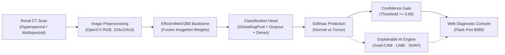

# Renal Spectral Diagnostic Platform: Deep Learning, Explainable AI & MLOps

[](https://www.python.org/)
[](https://tensorflow.org/)
[](https://dvc.org/)
[](https://mlflow.org/)
[](docs/TESTING_REPORT.md)
[](LICENSE)

An end-to-end, production-grade Deep Learning system for classifying renal disease (**Normal** vs. **Tumor**) from spectral computed tomography (CT) scans. The platform integrates **EfficientNetV2B0** transfer learning, multi-method **Explainable AI (Grad-CAM, LIME, Kernel SHAP)**, an experimental **Multimodal AI** clinical biomarker fusion blueprint, automated **MLOps pipelines (DVC, MLflow, Docker)**, and a modern diagnostic web dashboard.

---

## 1. Project Overview
Renal cell carcinoma (RCC) accounts for approximately 90% of all kidney malignancies. Early, accurate identification from diagnostic imaging is critical for surgical planning and nephron-sparing interventions. This platform operationalizes deep learning classification on spectral kidney CT scans while systematically addressing the black-box nature of deep neural networks through visual and mathematical explainability.

---

## 2. Problem Statement
Automated medical image classification faces three major clinical adoption barriers:
1. **Opaque Decision Making:** Deep neural networks do not inherently provide interpretable justifications for clinical decisions.
2. **Spectral & Imaging Variance:** Differences between Hyperspectral (continuous spectral bands) and Multispectral (discrete tissue density bands) scans affect feature distributions.
3. **Lack of Holistic Context:** Traditional computer vision models examine images in isolation, ignoring critical electronic health record (EHR) biomarkers such as serum creatinine and eGFR.

---

## 3. Project Objectives
- Build a modular, reproducible deep learning pipeline achieving $>90\%$ validation accuracy on renal spectral scans.
- Provide triangulated Explainable AI (XAI) using Grad-CAM, LIME, and Kernel SHAP.
- Formulate a dual-branch Multimodal Fusion architecture integrating imaging features with clinical lab biomarkers.
- Implement production MLOps practices: DVC pipeline orchestration, MLflow experiment logging, Docker containerization, and GitHub Actions CI/CD.
- Deliver an interactive, responsive web console featuring confidence gating and clinical disclaimers.

---

## 4. Technology Stack

| Layer | Technologies |
| :--- | :--- |
| **Deep Learning** | TensorFlow / Keras 2.12 (EfficientNetV2B0, Transfer Learning) |
| **Explainable AI (XAI)** | TensorFlow GradientTape (Grad-CAM), LIME (`lime_image`), SHAP (`KernelExplainer`) |
| **Computer Vision** | OpenCV (`cv2`), scikit-image (`slic`, `mark_boundaries`), NumPy |
| **Pipeline & MLOps** | DVC (Data Version Control), MLflow (DagsHub Remote Tracking) |
| **Web Backend & Serving** | Python Flask, Flask-CORS, In-Memory Model Cache (`ModelLoader`) |
| **Frontend UI** | HTML5, CSS3 Grid/Flexbox, Vanilla JS (Canvas 60fps Alpha Blending) |
| **DevOps & Cloud** | Docker, GitHub Actions, AWS ECR, AWS EC2 |
| **Testing & Quality** | pytest, python compileall, Flake8-compatible modular structure |

---

## 5. System Architecture



For detailed component decomposition, see [docs/PROJECT_ARCHITECTURE.md](docs/PROJECT_ARCHITECTURE.md).

---

## 6. Dataset Information
- **Total Dataset Size:** 20,000 CT scan images stored across structured modality partitions.
  - **Hyperspectral:** 5,000 Normal scans, 5,000 Tumor scans (10,000 scans total).
  - **Multispectral:** 5,000 Normal scans, 5,000 Tumor scans (10,000 scans total).
- **Split Protocol:** 80% Training subset, 20% Validation subset (`validation_split=0.20`).
- **Data Availability Note:** The dataset contains exclusively imaging data. No patient-identifiable private records or paired EHR lab panels are included in this release.

---

## 7. Deep Learning Architecture: EfficientNetV2B0

- **Input Dimension:** `(224, 224, 3)` RGB float32.
- **Base Feature Extractor:** Pretrained ImageNet-1k weights transferred to preserve low-level spatial and texture feature detectors (`freeze_all = True`).
- **Native Normalization:** EfficientNetV2B0 contains internal `Rescaling` and `Normalization` layers within the model graph, natively expecting unscaled raw `[0, 255]` pixel inputs.
- **Classification Head:**
  ```python
  x = tf.keras.layers.GlobalAveragePooling2D()(model.output)  # 1280-dim vector
  x = tf.keras.layers.Dropout(0.3)(x)                         # 30% regularization
  prediction = tf.keras.layers.Dense(units=2, activation="softmax")(x)
  ```
- **Label Mapping:** `0: Normal`, `1: Tumor`.

For complete architectural details, see [docs/MODEL_EXPLANATION.md](docs/MODEL_EXPLANATION.md).

---

## 8. Training Methodology
- **Loss Function:** Categorical Cross-Entropy.
- **Optimizer:** Adam ($lr = 0.01$).
- **Data Augmentation:** Rotation ($\pm 20^\circ$), Horizontal Flip, Width/Height Shift ($10\%$), Zoom ($20\%$).
- **Training Epochs:** 10 epochs with batch size 16.

---

## 9. Evaluation Metrics (Validation Split Results)

> **Methodological Disclosure:** The metrics below represent reproducible evaluations on the **20% validation split** of the repository dataset. There is no independent holdout test set in the current repository.

| Modality | Validation Loss | Validation Accuracy | Tumor Precision | Tumor Recall | Tumor F1-Score |
| :--- | :---: | :---: | :---: | :---: | :---: |
| **Hyperspectral** | `0.2096` | **94.22%** | **100.00%** | **88.44%** | **93.86%** |
| **Multispectral** | `0.3812` | **83.75%** | **78.57%** | **92.81%** | **85.10%** |

### Confusion Matrix (640 Balanced Validation Samples)
- **Hyperspectral:**
  $$\begin{pmatrix} 320 & 0 \\ 37 & 283 \end{pmatrix}$$
- **Multispectral:**
  $$\begin{pmatrix} 239 & 81 \\ 23 & 297 \end{pmatrix}$$

---

## 10. Explainable AI (XAI) Implementation

The system provides on-demand multi-method explainability to inspect model decisions:

### A. Grad-CAM (Gradient-weighted Class Activation Mapping)
- **Target Layer:** `top_activation` ($7 \times 7 \times 1280$).
- Uses `tf.GradientTape()` to calculate gradients of the target class score with respect to convolutional feature maps.
- Produces normalized spatial activation heatmaps overlaid with adjustable opacity ($\alpha$).

### B. LIME (Local Interpretable Model-Agnostic Explanations)
- Segments the scan into superpixels using SLIC.
- Evaluates $60\text{--}80$ local perturbations to fit a linear surrogate model.
- Highlights features that **positively support** (Green) vs. **oppose** (Red) the classification.

### C. Kernel SHAP (SHapley Additive exPlanations)
- Applies cooperative game theory to measure marginal Shapley attributions across superpixel segments.
- Satisfies foundational efficiency, symmetry, dummy, and additivity axioms.
- Visualized on a diverging `coolwarm` colormap (Warm/Red = Tumor push; Cool/Blue = Normal push).

For algorithmic derivations and comparisons, see [docs/XAI_DOCUMENTATION.md](docs/XAI_DOCUMENTATION.md).

---

## 11. Multimodal Architecture Blueprint

Designed as a future-ready extension for clinical EHR integration:
- **Imaging Branch:** EfficientNetV2B0 $\rightarrow$ Dense(128, ReLU).
- **Clinical Branch:** 6 tabular biomarkers (Age, Creatinine, BUN, eGFR, Systolic BP, Hemoglobin) $\rightarrow$ Dense(64) $\rightarrow$ BatchNormalization $\rightarrow$ Dense(32, ReLU).
- **Fusion Layer:** Concatenation (160 dimensions) $\rightarrow$ Dense(64, ReLU) $\rightarrow$ Dropout(0.3) $\rightarrow$ Softmax(2).
- **Validation:** Enforces strict physiological bounds and z-score feature scaling.
- **Status:** Experimental architecture. No synthetic patient data has been fabricated.

For full clinical specifications, see [docs/MULTIMODAL_DOCUMENTATION.md](docs/MULTIMODAL_DOCUMENTATION.md).

---

## 12. MLOps Workflow: DVC, MLflow & CI/CD

- **DVC Pipeline (`dvc.yaml`):**
  - `data_ingestion` $\rightarrow$ `prepare_base_model` $\rightarrow$ `training` $\rightarrow$ `evaluation`.
- **MLflow Tracking:** Logs parameters, metrics (`loss`, `accuracy`, `f1_score`), and registers models under `EfficientNetV2B0_{modality}`.
- **Continuous Integration:** Automated GitHub Actions workflow executes `pytest` and bytecode validation on every push.
- **Continuous Deployment:** Containerized image built via `Dockerfile` and deployed to AWS ECR/EC2.

For MLOps setup details, see [docs/MLOPS_WORKFLOW.md](docs/MLOPS_WORKFLOW.md).

---

## 13. Flask Web Application

Features:
- Responsive dark-theme diagnostic console.
- Modality switcher (Hyperspectral vs. Multispectral).
- Drag-and-drop CT scan upload.
- Automated confidence gating (flags $< 0.65$ confidence as `Uncertain`).
- On-demand XAI computation (Grad-CAM, LIME, SHAP tabs).
- Real-time 60fps client-side canvas opacity slider.
- Multimodal architecture documentation tab.

---

## 14. Installation Instructions

### Prerequisites
- Python 3.8 to 3.10
- Conda (Miniconda or Anaconda recommended)

### Step 1: Clone Repository
```bash
git clone https://github.com/Pratham415/Kidney-Disease-classification.git
cd Kidney-Disease-classification
```

### Step 2: Create Conda Environment
```bash
conda create -n cnncls python=3.8 -y
conda activate cnncls
```

### Step 3: Install Dependencies
```bash
pip install --upgrade pip
pip install -r requirements.txt
```

> **Platform Notes:**
> - **Apple Silicon (M1/M2/M3):** `requirements.txt` automatically includes `tensorflow-macos` and `tensorflow-metal`.
> - **Linux / Windows:** Installs standard `tensorflow==2.12.0`.

---

## 15. Running the Application

Start the Flask server:
```bash
python app.py
```

Navigate to:
👉 **[http://localhost:8080](http://localhost:8080)**

---

## 16. Testing Instructions

Run the automated test suite (26 unit and integration tests):
```bash
pytest -v tests/
```

Run bytecode verification:
```bash
python -m compileall src app.py main.py
```

For test breakdown, see [docs/TESTING_REPORT.md](docs/TESTING_REPORT.md).

---

## 17. Environment Configuration

Copy the example environment template:
```bash
cp .env.example .env
```

Configure your DagsHub / MLflow variables in `.env`:
```env
MLFLOW_TRACKING_URI=https://dagshub.com/<YOUR_USERNAME>/Kidney-Disease-classification.mlflow
MLFLOW_TRACKING_USERNAME=<YOUR_USERNAME>
MLFLOW_TRACKING_PASSWORD=<YOUR_DAGSHUB_TOKEN>
PORT=8080
```

> **Offline Mode:** If `MLFLOW_TRACKING_URI` is omitted, the evaluation pipeline runs completely offline without network calls.

---

## 18. Limitations
1. **Validation vs. Test Split:** Metrics reflect a 20% validation split. External multi-center validation on unseen hospital datasets is necessary before clinical consideration.
2. **2D vs. 3D Volumetric Data:** Slices are classified as individual 2D images rather than complete 3D volumetric DICOM series.
3. **Multimodal Data Absence:** Paired clinical EHR records were unavailable in the open release; the multimodal model remains an architectural prototype.

---

## 19. Future Scope
- Expand 2D CNN architecture into 3D Volumetric ResNet / Vision Transformers for multi-slice CT scanning.
- Integrate Federated Learning for privacy-preserving training across hospital networks.
- Incorporate interactive human-in-the-loop radiologist annotation correction.

---

## 20. Medical & Research Disclaimer

> **IMPORTANT MEDICAL DISCLAIMER:**
> This software is an **educational and research prototype** developed for scientific demonstration of Deep Learning, Explainable AI, and MLOps techniques. **It is NOT a medical device, medical software, or diagnostic tool.** It has not received clearance or approval from the U.S. FDA, European EMA, or any international medical regulatory agency. It must never be used for clinical diagnosis, patient triage, treatment decisions, or surgical margins. All diagnostic evaluations must be conducted by qualified, licensed healthcare professionals.
