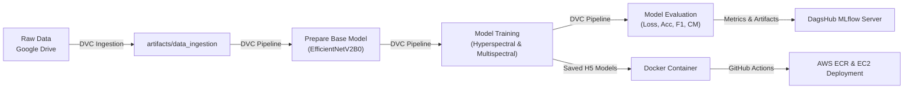

# MLOps Architecture & Engineering Workflow Manual

## 1. MLOps Ecosystem Overview

The Kidney Disease Classification platform implements reproducible, automated Machine Learning Operations (MLOps) principles across all stages of the model development lifecycle.



---

## 2. Stage-by-Stage DVC Pipeline Breakdown

Data Version Control (DVC) orchestrates deterministic execution and dependency tracking via `dvc.yaml`:

### Stage 1: Data Ingestion (`data_ingestion`)
- **Command:** `python src/cnnClassifier/pipeline/stage_01_data_ingestion.py`
- **Dependencies:**
  - `src/cnnClassifier/pipeline/stage_01_data_ingestion.py`
  - `config/config.yaml`
- **Outputs:**
  - `artifacts/data_ingestion/data` (20,000 CT scan images)
- **Role:** Automates downloading `data.zip` via `gdown` and extracting into structured modality folders.

### Stage 2: Base Model Preparation (`prepare_base_model`)
- **Command:** `python src/cnnClassifier/pipeline/stage_02_prepare_base_model.py`
- **Dependencies:**
  - `src/cnnClassifier/pipeline/stage_02_prepare_base_model.py`
  - `config/config.yaml`
- **Parameters (`params.yaml`):**
  - `IMAGE_SIZE: [224, 224, 3]`
  - `INCLUDE_TOP: False`
  - `CLASSES: 2`
  - `WEIGHTS: imagenet`
  - `LEARNING_RATE: 0.01`
- **Outputs:**
  - `artifacts/prepare_base_model/`

### Stage 3: Model Training (`training`)
- **Command:** `python src/cnnClassifier/pipeline/stage_03_training.py`
- **Dependencies:**
  - `src/cnnClassifier/pipeline/stage_03_training.py`
  - `config/config.yaml`
  - `artifacts/data_ingestion/data/data/hyperspectral`
  - `artifacts/data_ingestion/data/data/multispectral`
  - `artifacts/prepare_base_model`
- **Parameters (`params.yaml`):**
  - `EPOCHS: 10`
  - `BATCH_SIZE: 16`
  - `AUGMENTATION: True`
  - `IMAGE_SIZE: [224, 224, 3]`
- **Outputs:**
  - `artifacts/training/hyperspectral/model.h5`
  - `artifacts/training/multispectral/model.h5`

### Stage 4: Model Evaluation (`evaluation`)
- **Command:** `python src/cnnClassifier/pipeline/stage_04_evaluation.py`
- **Dependencies:**
  - `src/cnnClassifier/pipeline/stage_04_evaluation.py`
  - `config/config.yaml`
  - Data folders & trained model `.h5` files
- **Metrics Tracked:**
  - `scores.json` (`cache: false`)

---

## 3. MLflow Experiment Tracking & Remote Registry

The project integrates with DagsHub MLflow for centralized tracking:
- **Tracking URI:** `https://dagshub.com/<YOUR_DAGSHUB_USERNAME>/<YOUR_REPO_NAME>.mlflow`
- **Parameters Logged:** `EPOCHS`, `BATCH_SIZE`, `IMAGE_SIZE`, `LEARNING_RATE`, `AUGMENTATION`.
- **Metrics Logged:** `loss`, `accuracy`, `precision`, `recall`, `f1_score`.
- **Model Registry:** Serialized Keras `.h5` model artifacts are registered under `EfficientNetV2B0_hyperspectral` and `EfficientNetV2B0_multispectral`.

### Safe Credential Management
Credentials are strictly managed via environment variables or `.env`:
```bash
export MLFLOW_TRACKING_URI="https://dagshub.com/<USERNAME>/<REPO>.mlflow"
export MLFLOW_TRACKING_USERNAME="<USERNAME>"
export MLFLOW_TRACKING_PASSWORD="<TOKEN>"
```
If credentials are not supplied, the evaluation engine logs a warning and proceeds locally without crashing, ensuring offline reproducibility.

---

## 4. Continuous Integration & Continuous Deployment (CI/CD)

The GitHub Actions workflow at `.github/workflows/main.yaml` enforces end-to-end automation across 3 sequential jobs:

1. **Continuous Integration (`integration`):**
   - Environment: `ubuntu-latest`
   - Python Version: `3.10`
   - Steps: System dependency installation (`libgl1`), Python package installation (`pip install -r requirements.txt`), bytecode syntax check (`compileall`), and automated pytest execution (`pytest -v tests/`).
2. **Continuous Delivery (`build-and-push-ecr-image`):**
   - Triggered only upon successful CI completion.
   - Builds production Docker image using `Dockerfile`.
   - Pushes versioned image to Amazon Elastic Container Registry (ECR).
3. **Continuous Deployment (`Continuous-Deployment`):**
   - Runs on self-hosted EC2 runner.
   - Pulls latest container image from ECR.
   - Replaces running container with port forwarding `:8080` and passes encrypted GitHub repository secrets as environment variables.
