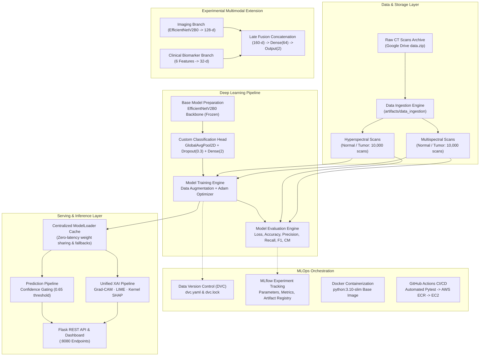

# Comprehensive System Architecture: Renal CT Deep Learning & MLOps Platform

## 1. High-Level Architectural Overview

The Kidney Disease Classification platform is designed as an end-to-end, reproducible, production-grade deep learning solution adhering to modern MLOps standards. The platform ingests renal computed tomography (CT) scan data across dual spectral modalities (**Hyperspectral** and **Multispectral**), processes scans through transfer-learning computer vision backbones, validates inferences through multi-method Explainable AI (XAI), and serves predictions through an asynchronous Flask web dashboard.



---

## 2. Component Deconstruction

### 2.1 Preprocessing & Input Validation Pipeline
- **File:** `src/cnnClassifier/utils/image_processing.py`
- **Specification:**
  - Enforces input file existence, regular file attributes, and non-zero byte size.
  - Decodes images via OpenCV preserving 3 color channels (RGB format).
  - Resizes to `(224, 224)` utilizing `cv2.INTER_AREA` for downscaling and `cv2.INTER_CUBIC` for upscaling.
  - Converts output to `float32` keeping raw pixel bounds `[0, 255]`.
  - Maintains strict consistency across Training, Validation, and Inference. EfficientNetV2B0 contains native internal `Rescaling` and `Normalization` layers, preventing double-scaling errors.

### 2.2 Deep Feature Extractor & Classification Head
- **Backbone:** Google EfficientNetV2B0 pretrained on ImageNet-1k.
- **Stem & MBConv Blocks:** Depthwise separable convolutions, Fused-MBConv stages, and Squeeze-and-Excitation (SE) attention modules extract hierarchical spatial representations.
- **Top Conv Layer:** `top_activation` produces a `(7, 7, 1280)` feature tensor representing high-level semantic activations.
- **Head:**
  - `GlobalAveragePooling2D()`: Collapses spatial dimensions `(7, 7, 1280) -> (1280,)`.
  - `Dropout(rate=0.3)`: Randomly zeroes activations during training to prevent co-adaptation.
  - `Dense(units=2, activation='softmax')`: Produces normalized posterior class probabilities $[P(\text{Normal}), P(\text{Tumor})]$ summing to 1.0.

### 2.3 Centralized Model Loader & Cache
- **File:** `src/cnnClassifier/utils/model_loader.py`
- **Design Pattern:** Thread-safe in-memory singleton cache.
- **Fallback Resolution Order:**
  1. `artifacts/training/{modality}/model.h5`
  2. `models/{modality}/model.h5`
- **Benefit:** Eliminates 1–3 second disk read latency per web prediction request and prevents duplicate memory allocation between inference and explainability pipelines.

### 2.4 Explainability Subsystem (Triangulated XAI)
- **File:** `src/cnnClassifier/pipeline/xai_pipeline.py`
- Three complementary explainability mechanisms operate on demand:
  1. **Grad-CAM (White-Box Feature Activation):** Computes exact gradients of target class output with respect to `top_activation` conv layer feature maps using `tf.GradientTape`.
  2. **LIME (Black-Box Local Surrogate):** Evaluates local decision boundary sensitivity by segmenting images into superpixels and perturbing superpixel subsets.
  3. **Kernel SHAP (Axiomatic Game Theory):** Measures marginal Shapley attribution values of superpixel coalitions with background masking.

### 2.5 Multimodal Architecture Blueprint
- **Files:** `src/cnnClassifier/components/multimodal.py`, `src/cnnClassifier/pipeline/multimodal_pipeline.py`
- **Input Modalities:**
  - Branch A: Renal CT Scan tensor `(224, 224, 3)`.
  - Branch B: Six standardized clinical biomarkers (Age, Serum Creatinine, BUN, eGFR, Systolic BP, Hemoglobin).
- **Fusion Mechanism:** Late-fusion feature concatenation `(128 + 32 = 160 dimensions)` followed by non-linear MLP projection and softmax output.
- **Status:** Experimental architecture ready for paired EHR dataset ingestion.

---

## 3. Directory Layout & Module Responsibilities

```
Kidney-Disease-classification/
├── .github/workflows/main.yaml       # CI/CD pipeline (lint, test, build, push)
├── .env.example                       # Credential placeholders for MLflow/DagsHub
├── .gitignore                         # Version control exclusions
├── Dockerfile                         # Container build definition (Debian Linux)
├── README.md                          # Comprehensive project documentation
├── app.py                             # Flask application server & REST endpoints
├── main.py                            # CLI execution entry point for MLOps stages
├── params.yaml                        # Central hyperparameters (epochs, lr, batch)
├── requirements.txt                   # Platform-aware dependency manifest
├── scores.json                        # Tracked evaluation metrics across modalities
├── setup.py                           # Python package distribution configuration
├── config/
│   └── config.yaml                    # Filepaths and dataset configurations
├── docs/                              # Technical reports, guides, and documentation
│   ├── PROJECT_AUDIT_REPORT.md        # Comprehensive repository audit
│   ├── PROJECT_ARCHITECTURE.md        # System architecture (this document)
│   ├── MODEL_EXPLANATION.md           # Deep learning architecture details
│   ├── XAI_DOCUMENTATION.md           # Grad-CAM, LIME, and SHAP manual
│   ├── MULTIMODAL_DOCUMENTATION.md    # Dual-branch multimodal AI manual
│   ├── MLOPS_WORKFLOW.md              # DVC, MLflow, CI/CD specifications
│   ├── TESTING_REPORT.md              # Automated pytest report
│   └── PROJECT_PRESENTATION_GUIDE.md  # Viva & defense presentation guide
├── models/                            # Committed standalone model weights
│   ├── hyperspectral/model.h5
│   └── multispectral/model.h5
├── src/cnnClassifier/
│   ├── components/                    # Core computational logic
│   │   ├── data_ingestion.py
│   │   ├── prepare_base_model.py
│   │   ├── training.py
│   │   ├── model_evaluation_mlflow.py
│   │   └── multimodal.py
│   ├── config/                        # Configuration manager
│   │   └── configuration.py
│   ├── constants/                     # Static path constants
│   ├── entity/                        # Dataclass configuration entities
│   ├── pipeline/                      # Orchestrated pipeline stages
│   │   ├── stage_01_data_ingestion.py
│   │   ├── stage_02_prepare_base_model.py
│   │   ├── stage_03_training.py
│   │   ├── stage_04_evaluation.py
│   │   ├── prediction.py
│   │   ├── xai_pipeline.py
│   │   └── multimodal_pipeline.py
│   └── utils/                         # Shared helper modules
│       ├── common.py                  # YAML, JSON, Base64 operations
│       ├── image_processing.py        # Safe image loading & resizing
│       ├── model_loader.py            # Centralized model caching & fallbacks
│       ├── xai_gradcam.py             # Grad-CAM algorithms
│       ├── xai_lime.py                # LIME algorithms
│       └── xai_shap.py                # Kernel SHAP algorithms
├── templates/
│   └── index.html                     # Responsive dark-theme dashboard UI
└── tests/
    └── test_xai_and_pipeline.py       # 26 automated unit and integration tests
```
