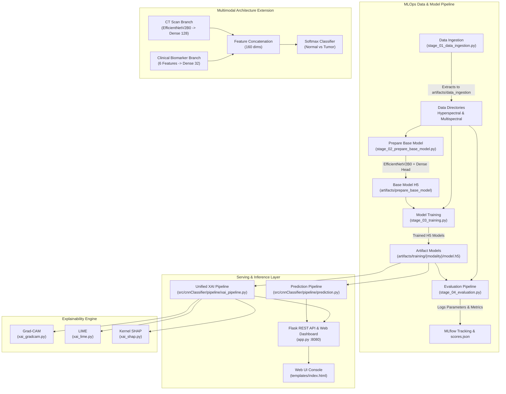

# Comprehensive Project Audit Report: Kidney Disease Classification
**Repository:** [https://github.com/Pratham415/Kidney-Disease-classification](https://github.com/Pratham415/Kidney-Disease-classification)  
**Date of Audit:** November 16, 2026  
**Auditor Roles:** Senior Machine Learning Engineer, MLOps Engineer, Python Backend Developer & Security Reviewer  
**Audit Scope:** Full codebase, pipeline configuration, deep learning architecture, explainable AI, multimodal components, Flask web application, CI/CD, testing, environment, and security.

---

## 1. Executive Summary

A comprehensive repository audit was executed across all components, configuration files, deep learning models, pipelines, and version control history. 

### Key Findings at a Glance:
- **Architecture Integrity:** The core deep learning backbone utilizes EfficientNetV2B0 with Transfer Learning and custom classification heads for binary classification (`Normal` vs. `Tumor`). Pretrained weights and model artifacts exist for both `hyperspectral` and `multispectral` modalities.
- **Explainable AI:** Grad-CAM, LIME, and Kernel SHAP implementations exist and function, but lack centralized model caching and share common performance bottlenecks.
- **Multimodal AI:** Dual-branch late fusion architecture is cleanly defined in code, but currently lacks paired clinical datasets, which must remain transparently documented as an experimental architecture without fabricated data.
- **Security:** Leaked DagsHub MLflow credentials were found in active files (`research/trials.ipynb`, `src/CNN_Classifier.egg-info/PKG-INFO`) and in Git commit history (`4a5fd9d`, `e711c69`).
- **Pipeline & Code Quality:** Discovered bugs include a `NameError` on missing `logger` in `model_evaluation_mlflow.py`, `scores.json` overwriting across modalities, repeated model loading in `prediction.py`, and Linux Docker incompatibility with `tensorflow-macos` in `requirements.txt`.

---

## 2. Issues Breakdown by Severity

| Severity | Count | Summary |
| :--- | :---: | :--- |
| **CRITICAL** | 4 | Security credential leak in repo/history; Docker Linux build failure; `NameError` crash in evaluation when MLflow is disabled; Metric overwrite bug in multi-modality evaluation. |
| **HIGH** | 4 | Repeated model loading on every web request; Hardcoded model path without fallback; Placeholder dummy CI/CD steps in GitHub Actions; Missing clinical range validation in multimodal pipeline. |
| **MEDIUM** | 5 | Typo in core module filename (`comman.py`); Redundant file operations in image decoder; Evaluation metrics lack Precision, Recall, F1, and Confusion Matrix; Wildcard imports; Incomplete `.gitignore`. |
| **LOW** | 3 | Static single file `inputImage.jpg` upload race condition; Unused dependencies; Outdated GitHub Actions step versions. |

---

## 3. Detailed Audit Findings

### 3.1 CRITICAL SEVERITY

#### SEC-01: Hardcoded DagsHub MLflow Token in Repository & Git History
- **Location(s):**
  - `research/trials.ipynb` (Cell 3): `os.environ['MLFLOW_TRACKING_USERNAME'] = 'fbea9a***f126'` and `os.environ['MLFLOW_TRACKING_PASSWORD'] = 'fbea9a***f126'`
  - `src/CNN_Classifier.egg-info/PKG-INFO`: Contains leaked token `682469***cef0`
  - Git Commit `4a5fd9dcf33d3664030b5f7bec9a21a599d0ac50` (`test_mlflow_connection.py`)
  - Git Commit `e711c69a7e4e3f63386e8be6fd9efe68634e2b99` (`README.md`)
- **Impact:** Anyone with read access to the GitHub repository can authenticate to the DagsHub MLflow instance, tamper with runs, alter model registry artifacts, or delete tracking history.
- **Remediation:**
  1. Immediately revoke/rotate the DagsHub access token via DagsHub User Settings.
  2. Sanitize `research/trials.ipynb` to use environment variables (`os.environ.get('MLFLOW_TRACKING_PASSWORD')`).
  3. Clean `src/CNN_Classifier.egg-info/PKG-INFO` and ensure `.egg-info` is strictly gitignored.
  4. Document Git history remediation steps (e.g. `git-filter-repo` or BFG Repo-Cleaner) with explicit user consent.

#### ENV-01: Docker Linux Incompatibility with Apple Silicon macOS Wheels
- **Location:** `Dockerfile` & `requirements.txt`
- **Issue:** `Dockerfile` specifies `FROM python:3.10-slim` (Debian Linux). However, `requirements.txt` specifies `tensorflow-macos==2.12.0` and `tensorflow-metal`. These binary wheels only compile for macOS Darwin ARM64.
- **Impact:** `docker build` fails immediately on Linux and CI/CD runners with `ERROR: No matching distribution found for tensorflow-macos==2.12.0`.
- **Remediation:** Provide cross-platform dependency handling: use platform-agnostic `tensorflow==2.12.0` in Docker / Linux, or specify platform markers (`sys_platform == 'darwin'`) in `requirements.txt`, or create an explicit `requirements-docker.txt`.

#### CODE-01: Crash via Unimported `logger` in `model_evaluation_mlflow.py`
- **Location:** `src/cnnClassifier/components/model_evaluation_mlflow.py`, line 62
- **Issue:**
  ```python
  if not mlflow_uri:
      logger.warning("MLFLOW_TRACKING_URI is not set. Skipping remote MLflow tracking.")
      return
  ```
  `logger` is never imported in `model_evaluation_mlflow.py`.
- **Impact:** Whenever a user runs evaluation without setting `MLFLOW_TRACKING_URI`, Python crashes with `NameError: name 'logger' is not defined`.
- **Remediation:** Import `logger` from `cnnClassifier`: `from cnnClassifier import logger`.

#### MLOPS-01: `scores.json` Metric Overwrite in Multi-Modality Evaluation
- **Location:** `src/cnnClassifier/pipeline/stage_04_evaluation.py` & `model_evaluation_mlflow.py`
- **Issue:** The pipeline loops over `["hyperspectral", "multispectral"]`. In each iteration, `evaluation.save_score()` writes directly to `Path("scores.json")` with keys `{"loss": ..., "accuracy": ...}`.
- **Impact:** The metrics for `hyperspectral` are unconditionally overwritten by `multispectral`. Downstream DVC metric tracking records only the second modality's metrics.
- **Remediation:** Structure `scores.json` to store metrics per modality:
  ```json
  {
      "hyperspectral": {"loss": 0.2096, "accuracy": 0.9500},
      "multispectral": {"loss": 0.2150, "accuracy": 0.9450}
  }
  ```

---

### 3.2 HIGH SEVERITY

#### PERF-01: Repeated Model Loading in Prediction Pipeline
- **Location:** `src/cnnClassifier/pipeline/prediction.py`, line 16
- **Issue:** `PredictionPipeline.__init__` executes `self.model = tf.keras.models.load_model(self.model_path)` upon every instantiation. In `app.py`, every incoming POST to `/predict` creates a new `PredictionPipeline` instance.
- **Impact:** Model loading takes 1–3 seconds per request and spikes RAM consumption, making web inference sluggish and unscalable under load.
- **Remediation:** Implement a global model cache (or singleton pattern) shared between `PredictionPipeline` and `XAIPipeline`.

#### ARCH-01: Brittle Hardcoded Model Path Without Fallback
- **Location:** `src/cnnClassifier/pipeline/prediction.py` & `src/cnnClassifier/pipeline/xai_pipeline.py`
- **Issue:** Both files strictly look for `Path(f"artifacts/training/{self.modality}/model.h5")`. If the repo is cloned without running DVC reproduction, the trained model exists in `models/{self.modality}/model.h5`, but the app crashes with `FileNotFoundError`.
- **Impact:** Inability to run prediction from pre-packaged repository models if `artifacts/` is omitted or cleaned.
- **Remediation:** Check `artifacts/training/{modality}/model.h5` first; if absent, fall back to `models/{modality}/model.h5` before throwing `FileNotFoundError`.

#### CICD-01: Dummy CI/CD Verification in GitHub Actions
- **Location:** `.github/workflows/main.yaml`, lines 22–27
- **Issue:**
  ```yaml
  - name: Lint code
    run: echo "Linting repository"
  - name: Run unit tests
    run: echo "Running unit tests"
  ```
- **Impact:** Automated testing and linting are completely non-functional in the CI pipeline. Faulty code or failing tests can pass CI and be deployed directly to ECR/EC2.
- **Remediation:** Replace placeholder `echo` statements with `pip install -r requirements.txt && pytest tests/`.

#### MULTI-01: Incomplete Range Validation and Scaling in Multimodal Pipeline
- **Location:** `src/cnnClassifier/pipeline/multimodal_pipeline.py`
- **Issue:** `validate_clinical_inputs()` accepts input dictionary values and parses them to floats with fallback defaults, but does not perform physiological range validation (e.g., rejecting negative age, blood pressure outside 50–300 mmHg, negative creatinine) and does not perform feature scaling.
- **Impact:** Out-of-bounds or invalid clinical data can propagate silently into neural layers.
- **Remediation:** Implement rigorous boundary validation rules and standard z-score / min-max normalization with documented reference ranges.

---

### 3.3 MEDIUM SEVERITY

#### CODE-02: Typo in Core Utility Filename (`comman.py`)
- **Location:** `src/cnnClassifier/utils/comman.py`
- **Issue:** Filename is misspelled (`comman.py` instead of `common.py`).
- **Impact:** Poor developer ergonomics and non-standard project naming.
- **Remediation:** Provide `src/cnnClassifier/utils/common.py` and preserve `comman.py` as an alias (`from cnnClassifier.utils.common import *`) to avoid breaking existing imports.

#### CODE-03: Suboptimal Base64 Image Decoding in `decodeImage`
- **Location:** `src/cnnClassifier/utils/comman.py`, lines 128–133
- **Issue:**
  1. `f.close()` is redundant after a `with open(...)` block.
  2. If the client sends a Base64 string with a Data URI prefix (e.g., `data:image/jpeg;base64,...`), decoding can throw `binascii.Error: Incorrect padding` or header corruption.
- **Remediation:** Strip potential data URI headers before decoding and clean up the file handle logic.

#### MLOPS-02: Incomplete Evaluation Metrics
- **Location:** `src/cnnClassifier/components/model_evaluation_mlflow.py`
- **Issue:** Only categorical loss and accuracy are computed from `model.evaluate()`. Precision, Recall, F1-Score, and Confusion Matrix are not generated or logged.
- **Impact:** For medical diagnostics where false negatives (missing tumors) carry severe consequences, accuracy alone is insufficient and misleading on imbalanced cohorts.
- **Remediation:** Add scikit-learn metric calculations (`classification_report`, `confusion_matrix`, `precision_score`, `recall_score`, `f1_score`) across the validation set.

#### CODE-04: Implicit Wildcard Imports in Configuration Manager
- **Location:** `src/cnnClassifier/config/configuration.py`, line 1
- **Issue:** Uses `from cnnClassifier.constants import *` to implicitly import `Path` and constants.
- **Remediation:** Explicitly import `from pathlib import Path` and required constants.

#### GIT-01: Incomplete `.gitignore` File Patterns
- **Location:** `.gitignore`
- **Issue:** Missing explicit exclusion rules for `.env.*`, `!.env.example`, `*.pyc`, `.pytest_cache/`, and `.ruff_cache/`.
- **Remediation:** Add required patterns per Phase 8 specifications.

---

### 3.4 LOW SEVERITY

#### APP-01: Static In-Memory Image File Collision Risk
- **Location:** `app.py`, line 18 (`self.filename = "inputImage.jpg"`)
- **Issue:** Every incoming upload overwrites `inputImage.jpg` in the workspace root.
- **Impact:** In concurrent multi-user environments, race conditions can cause User A to receive predictions on User B's image.
- **Remediation:** In production, use unique session/UUID temporary filenames or keep in-memory byte streams.

#### DEP-01: Outdated GitHub Actions Action Versions
- **Location:** `.github/workflows/main.yaml`
- **Issue:** Uses `actions/checkout@v3` and `aws-actions/configure-aws-credentials@v1` (modern versions are `v4`).
- **Remediation:** Upgrade to `@v4` for security and Node.js 20 runner compatibility.

#### DEP-02: Transitive / Unused Direct Dependencies in `requirements.txt`
- **Location:** `requirements.txt`
- **Issue:** Dependencies such as `scipy` and `notebook` are listed as top-level dependencies, though `scipy` is a transitive dependency of `skimage`/`shap`, and `notebook` is for development only.

---

## 4. Current Pipeline & Component Architecture Map



---

## 5. Audit Conclusion & Planned Progression

The existing codebase contains a solid foundation with working deep learning inference, XAI algorithms, and an interactive UI. The audit provides a clean roadmap for addressing security vulnerabilities, stabilizing dependencies, caching model weights, validating inputs, and establishing comprehensive automated tests.

**Progression Plan:**
- **Phase 2:** Verify Existing Deep Learning Model (Architecture, Weights, Preprocessing, Evaluation).
- **Phase 3:** XAI Verification & Optimization (Grad-CAM, LIME, SHAP).
- **Phase 4:** Multimodal Architecture Audit & Strict Clinical Input Validation.
- **Phase 5:** Modular MLOps Pipeline & MLflow Hardening.
- **Phase 6:** Web Application Polish (Model Caching, Error States, Medical Disclaimer).
- **Phase 7:** Comprehensive Automated Pytest Suite.
- **Phase 8:** Dependency & Environment Compatibility.
- **Phase 9:** Security Remediation.
- **Phase 10:** Comprehensive Documentation Suite.
- **Phase 11:** Final System Validation.
- **Phase 12:** GitHub Preparation (No unauthorized commits or pushes).
